# 跨境贸易行业数据分析及可视化

面向出口企业回答三个问题：**卖什么、卖到哪、优先投哪个市场。**

数据来自联合国 UN Comtrade 2020–2024 年双边贸易年度数据，覆盖 **169 个报告国、96 个 HS 章节**，
278 个源文件合并后约 **370 万行**，最终用 Power BI 做成 **8 页交互式看板**，支持宏观 → 国家 → HS 品类三级钻取。

> 姊妹项目：[olist-gmv-analysis](https://github.com/lisking805/olist-gmv-analysis)
> （跨境电商平台 GMV 拆解与增长质量诊断）

---

## 一、看板成品（Power BI 8 页，选 7 页）

### 1. 总览：中国进出口整体情况

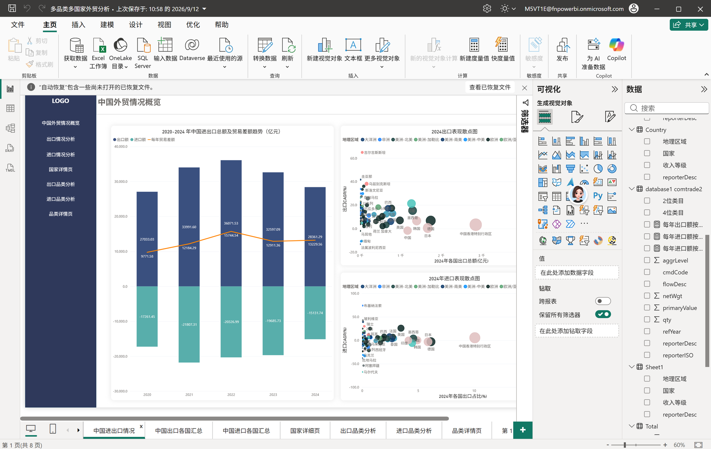

### 2. 出口 / 进口国家汇总

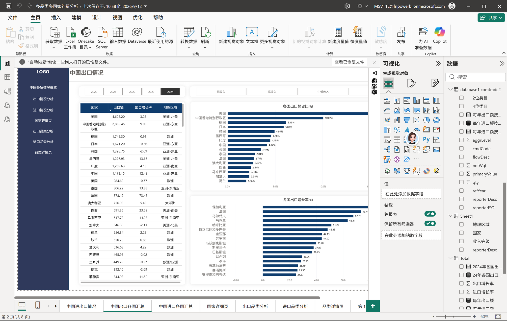

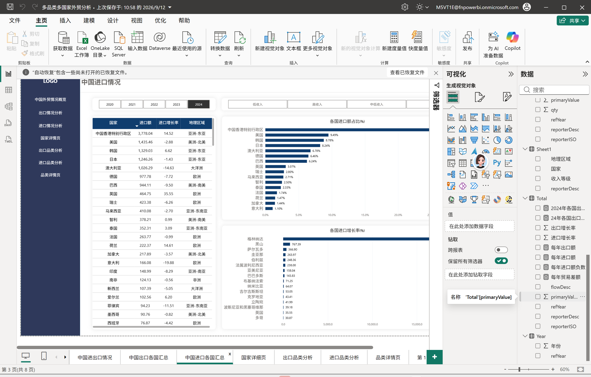

### 3. 二级钻取：单国 × HS 品类

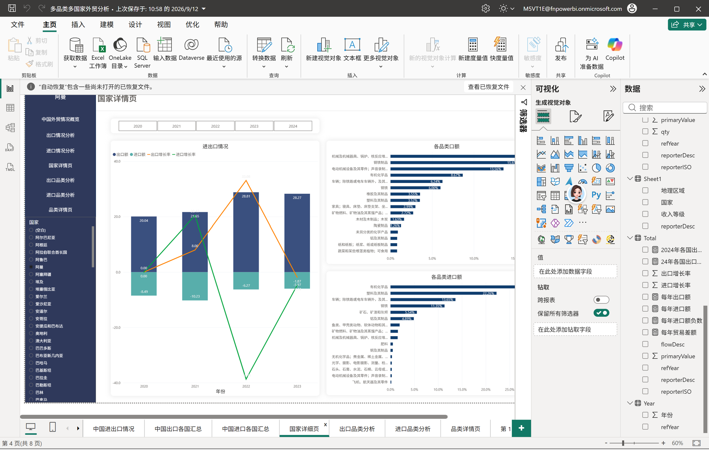

### 4. 出口 / 进口品类分析

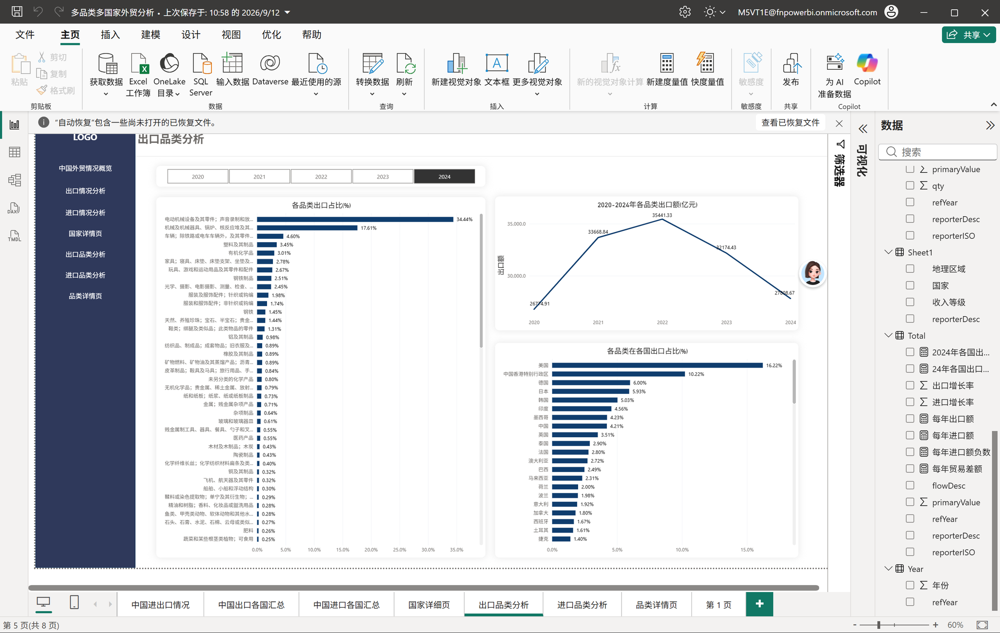

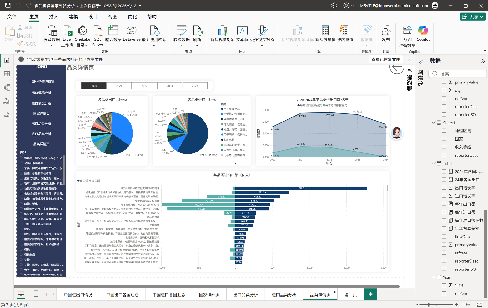

### 5. 二级钻取：单品类 × 国家

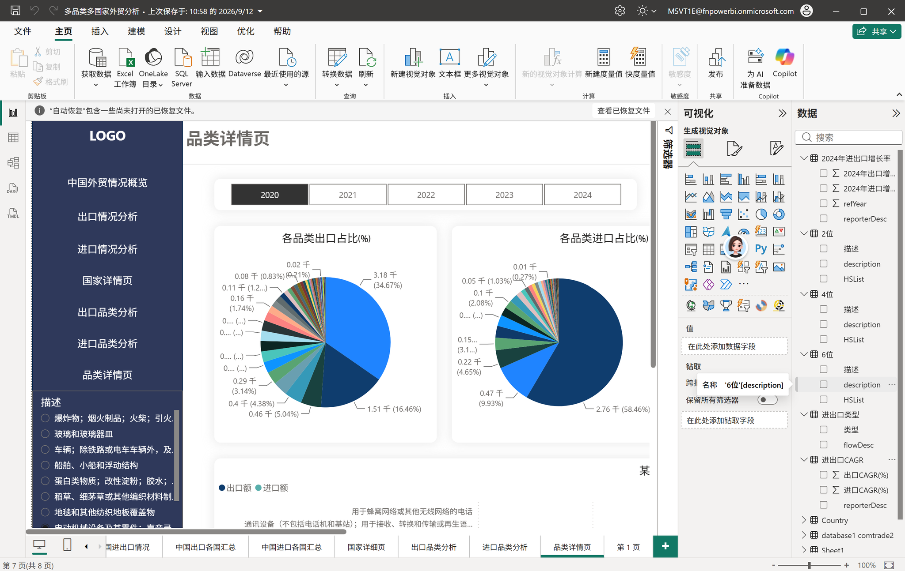

---

## 二、仓库结构

```
├── README.md
├── py/                  Python：入库 / 导出 / 表血缘
│   ├── 01_入库.py
│   ├── 05_导出Excel.py
│   └── 06_表血缘.py
├── sql/                 MySQL：质量校验 / 指标加工 / 结果查看 / 四象限
│   ├── 02_质量校验.sql
│   ├── 03_指标加工.sql
│   ├── 04_结果查看.sql
│   ├── 05b_补充分析.sql
│   ├── 07_核心数字复核.sql
│   └── 08_四象限2020_2023.sql
├── outputs/             7 张结果表（xlsx）
├── doc/                 全流程复现手册（第 0~10 章 + 验收数字 + 文件清单）
└── img 说明：看板图 P1–P7、过程图 b01–b04 位于根目录，供上方 README 直接引用
```

**跑起来需要什么**：`pandas`、`pymysql`、本地 MySQL 8.0。
数据库连接走环境变量（`DB_HOST` / `DB_USER` / `DB_PASSWORD`），代码里不写死密码。

---

## 三、数据概览

| 项目 | 数值 |
|---|---|
| 数据期间 | 2020 – 2024（年度） |
| 报告国数 | 169 |
| HS 章节数 | 96 |
| HS 层级 | 2 / 4 / 6 位 |
| 源文件 | 278 个 CSV |
| 合并后行数 | 约 370 万行 |
| 宽表入库（表 `a`） | 3,331,529 行 × 9 列 |
| 指标底表 | **7 张** |

---

## 四、三条核心结论

### 1. 结构：机电类占半壁江山，三年没有迁移

机电类（**HS84 + HS85**）占 2023 年出口的 **51.88%**，三年稳定在 **50%–53%** 区间。

→ 出口结构没有发生迁移。要找增长点，得往机电之外看。

### 2. 变化：汽车类是唯一的爆发式增长

汽车类（**HS87**）从 2020 年的 **656 亿美元**增至 2023 年的 **1,449 亿美元**，
年均复合增长 **30.22%**。

→ 用几何平均算（末年 ÷ 首年，再开 n 次方），不是「增长额 ÷ 年数」——增长是复利。

### 3. 分散：出口目的地在变分散

出口前五国集中度 **CR5** 从 2020 年的 **41.75%** 降至 2023 年的 **36.51%**。

→ 抗风险能力变强了，但代价是**没有形成压倒性的主力市场**，谈不上规模优势。

> ⚠️ **CR5 的结论截止 2023 年，不能算到 2024**，原因见第六节第 3 条。

---

## 五、市场优先级四象限

按「规模 × 增速」把 HS 品类切成四类（`t_quadrant`，87 行）：

| 象限 | 含义 | 策略 |
|---|---|---|
| 高规模 · 高增速 | 核心盘 | 稳住资源，盯份额 |
| 低规模 · 高增速 | 潜力 | 值得主动投资源 |
| 高规模 · 低增速 | 现金牛 | 保住即可，不必加码 |
| 低规模 · 低增速 | 观察区 | 维持，不做投入 |

分位**按中位数切，不用均值**——品类之间规模差距极大（机电一个大类顶后面几十个），
用均值切会把绝大多数品类全挤进「低规模」那一格，四象限就失效了。

---

## 六、口径与边界（这四条比结论更重要）

### 1. 这是「报告国视角」的镜像数据

报告国的 Import = 中国出口。全部分析已做换向处理。
**方向搞反，结论正好颠倒。**

### 2. 金额汇总只取 HS 2 位层级

同一批货在 2/4/6 位各被记录一次，三层直接 `SUM`，金额直接**翻三倍**。
→ 这是整个项目最关键的一次粒度决策：**只取 `aggrLevel = 2` 算总额**。

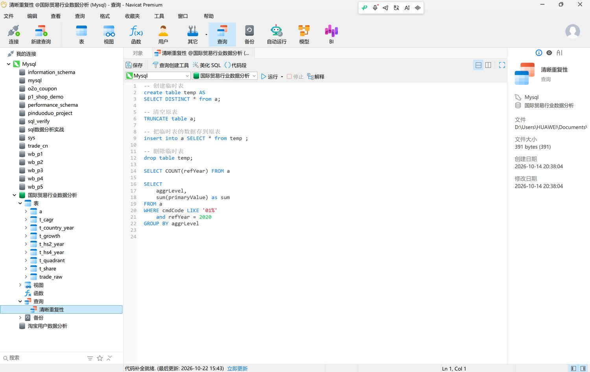

### 3. 2024 年只有 87/169 国报送数据

因此**增速类指标统一采用 2020–2023**；2024 只用于当年结构展示，不参与增速计算。

> **反面教材**：如果直接拿 2024 算 CR5，会得到 **43.71%**，
> 看起来像「集中度上升」，跟真实的 **36.51%** —— **结论完全相反**。

> 📌 教训：**拿到跨年面板数据，先逐年 `COUNT(DISTINCT 国家)`，别急着算趋势。**

### 4. 只有贸易额，没有利润和成本

结论用于**市场初筛**，不替代商业决策。

---

## 七、过程留痕

### 采集：网页单次查询有上限，必须按「年份 × HS 层级」分批下载

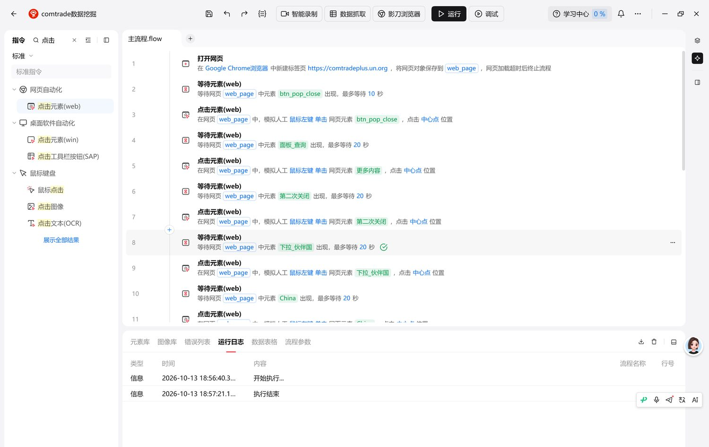

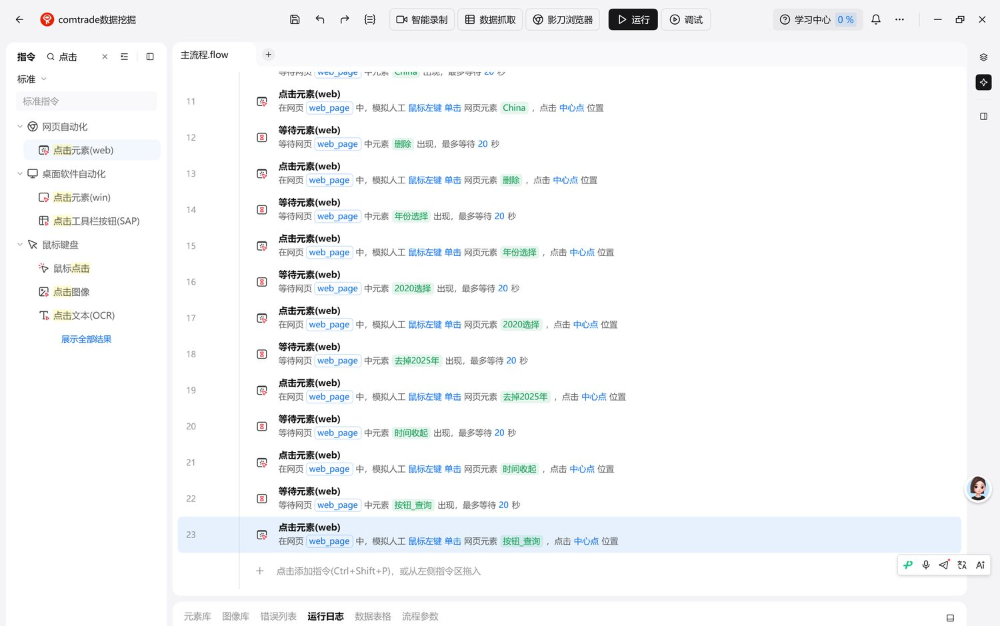

### 净重字段在 HS2 层级全为空，到 HS4 才有值

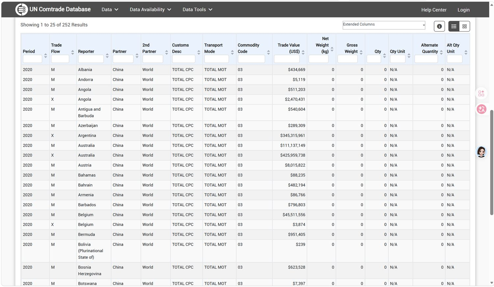

---

## 八、七张指标表

| 表名 | 内容 |
|---|---|
| `t_hs2_year` | HS2 章节 × 年份 |
| `t_hs4_year` | HS4 品类 × 年份 |
| `t_country_year` | 国家 × 年份 |
| `t_share` | 品类占比 |
| `t_growth` | 同比 / 环比增长率 |
| `t_cagr` | 复合增长率 |
| `t_quadrant` | 市场优先级四象限（87 行） |

表之间的依赖关系见 `py/06_表血缘.py`。

---

## 九、踩过的坑

1. **报告国视角搞反**。用 Import 还是 Export，取决于你要谁的出口。这个错了整篇都反。

2. **HS 三层重复计数**。汇总前必须先锁死层级。这一条最贵——不注意，金额直接虚增 3 倍。

3. **最后一年数据不全**。169 个国家里只有 87 个报了 2024。
   → 教训：**拿到跨年面板数据，先逐年 `COUNT(DISTINCT 国家)`，别急着算趋势。**

4. **CAGR 用错算法**。用「末年减首年 ÷ 年数」会把复利算成单利，30.22% 会变成完全不同的数。

5. **四象限不能用均值切分**。规模分布极度右偏，均值切会让四象限退化成一格。

6. **净重字段在 HS2 层级全为空，到 HS4 才有值**。做重量类分析只能用 4 位及以上层级。

---

## 十、工具分工

没有为了用某个工具而用它——每一步都有明确的不可替代性。

| 工具 | 用在哪 | 为什么 |
|---|---|---|
| 影刀 RPA | 采集 278 个源文件 | Comtrade 网页版单次查询有上限，需按「年份 × HS 层级」循环下载 |
| Python (pandas) | 字段清洗、去重、入库 | 278 个文件列名与编码不一致，手工合并不可靠 |
| MySQL 8.0 | 存储 + 7 张指标表加工 | 370 万行在 Excel 里打不开 |
| Power BI + DAX | 8 页交互看板 | 手写度量值动态算同比与占比，配切片器做宏观→国家→HS 三级钻取 |

---

## 十一、数据来源

[UN Comtrade](https://comtradeplus.un.org/)（联合国商品贸易统计数据库）
Reporter = All，Partner = China，Flow = Import / Export，HS 2/4/6，2020–2024。

原始 278 个 CSV 共约 **1.5 GB**，体积过大不随仓库提供，按上述条件可自行获取。
`outputs/` 里是加工后的 7 张结果表，可直接查看结论；
`doc/复现手册.md` 是逐步复现说明。

---

*李境 · 2026 年 10 月 · 山东财经大学 大数据管理与应用（金融大数据）卓越创新班 2028 届*
